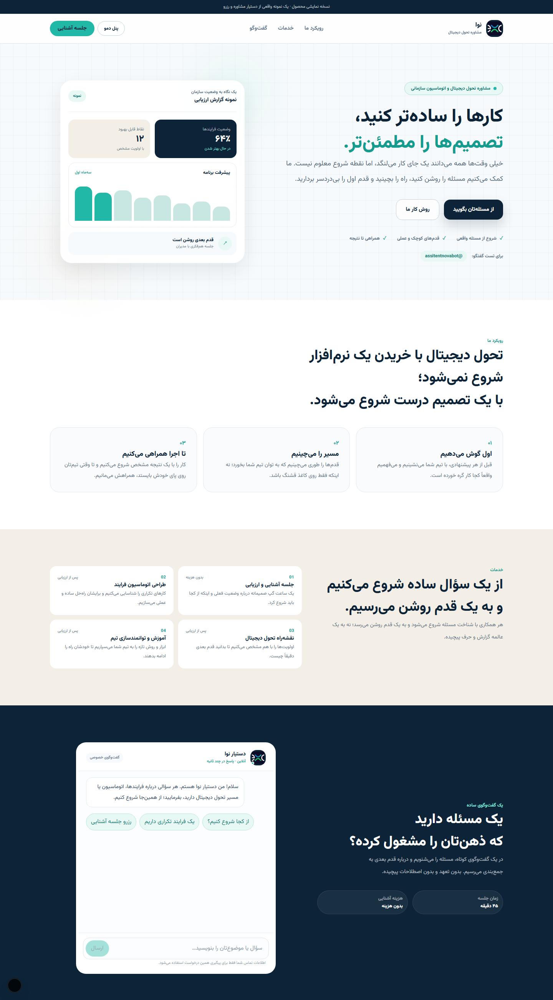
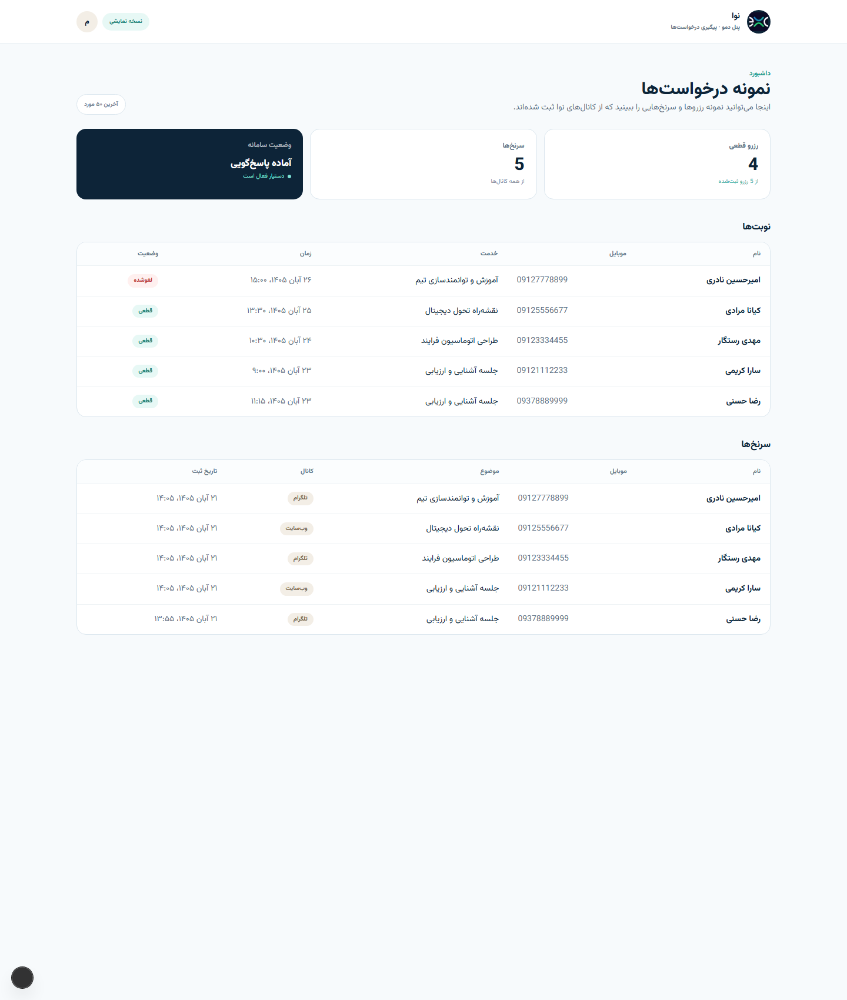

# 🤖 Nova — AI Booking & Lead Assistant

**Nova** is a production-shaped AI assistant for a digital transformation consultancy. It answers questions, captures qualified leads and books meetings through **web chat and Telegram** — all through one agent core, one conversation model and one admin dashboard. The core is channel-agnostic, so a WhatsApp adapter can plug into the same `runAgent()` entry point.

Built with **Next.js 15, TypeScript, Tailwind CSS, PostgreSQL and Gemini**, with a **Persian-first RTL interface**, a real tool-calling loop and a booking engine that cannot double-book a slot.

> ⚡ **Portfolio Project** — Demonstrates multi-channel AI agents, tool calling, conflict-safe booking, webhook idempotency and RTL product design.

[](https://nova-assistant-kappa.vercel.app/)
[](https://t.me/assitentnovabot)

---

## 🛠 Tech Stack


---

## ✨ Key Features

- 💬 **One agent core, channel-agnostic** – Web chat and Telegram both call the same `runAgent()` function, so behaviour, memory and tools stay consistent; a WhatsApp adapter can reuse it as-is
- 🧠 **Real tool calling** – The model checks availability, creates bookings, cancels appointments and saves leads instead of inventing answers
- 📅 **Conflict-safe booking** – A partial unique index on confirmed start times plus an atomic insert means two people can never take the same slot
- 🔁 **Idempotent webhooks** – Every Telegram update is stored before processing, so platform retries never create duplicate replies or bookings
- 🗓 **Persian calendar mapping** – The system prompt converts Jalali dates to ISO dates and only allows bookings inside the defined window
- 🔔 **Owner notifications** – Every new booking, cancellation and lead is pushed to the business owner on Telegram
- 🛡 **Signed webhooks** – Telegram updates are rejected unless the `X-Telegram-Bot-Api-Secret-Token` header matches the configured secret
- 🔐 **Admin authentication** – JWT sessions signed with `jose`; the demo build intentionally opens `/admin` without a password
- 📊 **Admin dashboard** – Booking and lead tables, status badges, channel labels, empty states and Persian date formatting
- 🎨 **RTL design system** – Token-based colours, spacing, radii and elevation; Vazirmatn self-hosted through `@fontsource` with no Google Fonts request
- ♿ **Accessibility** – Skip link, semantic landmarks, table captions, labelled inputs, `aria-live` chat log, visible focus rings and reduced-motion support
- 📱 **Responsive by default** – Mobile-first layout with a 390px-safe chat composer and horizontally scrollable data tables

---

## 📸 Visual Preview

<div align="center">

### 🏠 Landing Page

*Hero, consultancy narrative, service cards and the embedded booking assistant.*



---

### 📊 Admin Dashboard

*Bookings, leads, channel labels and status badges — seeded with demo records.*



---

### 🔗 Live Demo

**[nova-assistant-kappa.vercel.app](https://nova-assistant-kappa.vercel.app/)**

**Telegram:** [@assitentnovabot](https://t.me/assitentnovabot)

</div>

---

## 🧩 How It Works

1. **Channel entry** – `/api/chat` and `/api/telegram` normalise the incoming message into `{ channel, externalId, text }`
2. **Conversation memory** – `runAgent()` upserts the conversation, applies a per-hour rate limit and loads the last 20 messages from Postgres
3. **Prompt** – `buildSystemPrompt()` injects the live Tehran time, a 14-day Jalali/ISO calendar, services and booking rules
4. **Tool loop** – Gemini can call `check_availability`, `book_appointment`, `cancel_booking` and `save_lead` for up to six steps
5. **Persistence** – Bookings, leads and every message are written to Postgres; confirmed slots are protected by a partial unique index
6. **Notification** – The owner receives a Telegram message for each booking, cancellation and lead

---

## 🗂 Project Structure

| Path | Description |
| --- | --- |
| `src/app/page.tsx` | Persian landing page with hero, approach, services and chat section |
| `src/components/ChatWidget.tsx` | Streaming-free chat UI, session persistence and error states |
| `src/app/admin/page.tsx` | Admin dashboard for bookings and leads |
| `src/app/admin/login/page.tsx` | Password login (kept for non-demo deployments) |
| `src/middleware.ts` | Admin route guard; open by design in the demo build |
| `src/app/api/chat/route.ts` | Web channel endpoint |
| `src/app/api/telegram/route.ts` | Telegram webhook with secret validation and event deduplication |
| `src/lib/agent.ts` | Conversation loading, rate limiting, model call and persistence |
| `src/lib/tools.ts` | Availability, booking, cancellation and lead tools |
| `src/lib/slots.ts` | Working-day grid, free-slot calculation and timezone conversion |
| `src/lib/prompt.ts` | System prompt with live calendar and service catalogue |
| `src/lib/notify.ts` | Telegram and WhatsApp delivery helpers |
| `src/lib/auth.ts` | JWT signing and verification |
| `src/db/schema.ts` | Conversations, messages, leads, bookings and processed events |
| `src/app/globals.css` | Design tokens, typography, RTL rules and accessibility primitives |

---

## 🚀 Setup

```bash
git clone https://github.com/condev-dev/nova-assistant.git
cd nova-assistant
npm install
```

Create `.env.local` from the example and fill in your credentials:

```bash
cp .env.example .env.local
```

| Variable | Purpose |
| --- | --- |
| `DATABASE_URL` | Neon Postgres connection string |
| `GOOGLE_GENERATIVE_AI_API_KEY` | Gemini API key |
| `GEMINI_MODEL` | Model id, e.g. `gemini-3-flash-preview` |
| `TELEGRAM_BOT_TOKEN` | Bot token from BotFather |
| `TELEGRAM_WEBHOOK_SECRET` | Secret sent with every Telegram update |
| `OWNER_TELEGRAM_CHAT_ID` | Chat that receives booking notifications |
| `ADMIN_PASSWORD` | Password for the non-demo admin login |
| `ADMIN_SECRET` | 32+ character secret used to sign admin JWTs |
| `WHATSAPP_*` | Reserved for the optional Meta Cloud API adapter |

Push the schema and start the app:

```bash
npm run db:push
npm run dev
```

Open **http://localhost:3000** for the product, **http://localhost:3000/admin** for the dashboard.

### Local Telegram testing

```bash
cloudflared tunnel --url http://localhost:3000 --protocol http2
```

Then register the tunnel as the bot webhook:

```bash
curl "https://api.telegram.org/bot$TELEGRAM_BOT_TOKEN/setWebhook" \
  -d "url=https://YOUR-TUNNEL.trycloudflare.com/api/telegram" \
  -d "secret_token=$TELEGRAM_WEBHOOK_SECRET"
```

---

## 🧪 Scripts

| Command | Description |
| --- | --- |
| `npm run dev` | Start the development server |
| `npm run build` | Production build |
| `npm run start` | Serve the production build |
| `npm run lint` | ESLint checks |
| `npm run db:push` | Apply the Drizzle schema to Postgres |

---

## ⚠️ Demo Notes

- `/admin` is intentionally **public** in this demo build.
- Records shown in the dashboard are a mix of one real test booking and clearly fictional demo entries.
- The assistant never invents prices, clients or metrics; unknown answers fall back to a human follow-up.
- Gemini free-tier quotas are limited, so the demo may show a temporary service message when the daily quota is exhausted.

---

## 📄 License

[](LICENSE)

**© ConDev** — All rights reserved.
